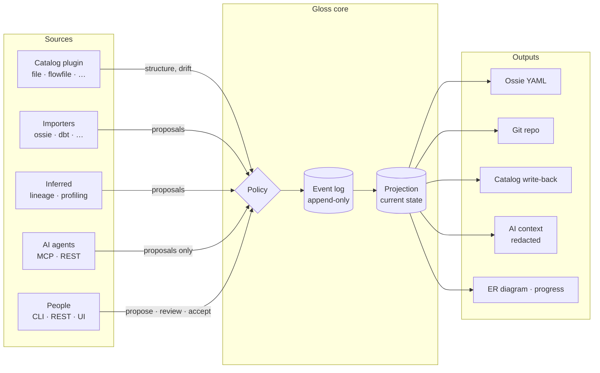

# Architecture

## Separation of concerns

| Layer | Owns | Does not own |
|---|---|---|
| **Apache Ossie** | The *format* of a semantic model: datasets, fields, relationships, metrics, AI context | Workflow, review, confidentiality, history |
| **Gloss core** | Facts about the model, their lifecycle, the event log, the mechanism of review and scoped reads, projections | Any specific catalog, tool or UI; who the users are; what they are allowed |
| **The host's policy** | Who may do what, what is accepted without review, who reads what | The mechanism |
| **Plugins** | Talking to a specific catalog, importer, exporter or AI | The workflow rules |

## The log and the projection

- `gloss_events(seq, id, ts, type, assertion_id, subject, actor, via, correlation, data)`: append-only.
- `gloss_assertions(...)`: current state per assertion; written in the same transaction as its events,
  together with the search rows that change.
- `model.apply_event(state, event) -> state` is a pure function; `Gloss.rebuild_projection()`
  replays the log to recreate the projection exactly. This is what makes "log of all semantic
  metadata" a guarantee rather than a feature.
- `gloss_assets(catalog, key, fingerprint, schema)`: last seen physical shape per catalog asset;
  used for drift detection only.

Event types: `proposed`, `corroborated`, `reviewed`, `accepted`, `rejected`, `reopened`,
`superseded`, `marked_stale`, `retracted`, `restored`, `rekeyed`, `commented`.

Three things are written into events and can therefore never be changed afterwards, so they were
settled first:

- **How subjects are named.** By name, with an owning namespace on every kind (`metric:sales::revenue`).
- **How actors are named.** `kind:id`, where the id is opaque and the host resolves it to a person.
- **What is decided as a unit.** A proposal `group`, binding for relationships and metrics.

## Decisions

**Facts, not documents.** An Ossie document is generated from accepted facts; it is never the unit of
review. That lets 10,000 objects be reviewed field by field, in parallel, by different people.

**Own store, git as an output.** Review state per field, cross-cutting queries ("all AI suggestions
awaiting review in finance"), and many concurrent reviewers fit a database; they don't fit files.
The `git` sink publishes accepted Ossie YAML for versioned, PR-reviewable releases, and its commit
message records the log position it reflects.

**Imports are proposals.** A file, an AI or a catalog description is a claim. Only structural facts
from catalogs are auto-accepted, because the catalog is the authority on physical structure.

**Stable, catalog-independent subjects.** Facts attach to `dataset:shop.orders`, not to a catalog's
internal id. Catalog plugins map their identifiers to keys, so catalogs can be swapped or combined.

**Names are the key, and a move is an event.** A catalog's row ids differ between machines and can be
reused after a delete, so they cannot identify a table; its qualified name is the only key every
machine shares. The cost of name-based keys is that a rename looks like a deletion. Gloss pays that cost
explicitly: the catalog of record reports the rename and every affected assertion gets a `rekeyed`
event whose fold replaces the subject (or a value that names one). History follows the subject because
it is read through assertion ids, not subject strings. The operation works on a path prefix, so renaming
a schema is the same mechanism as renaming a table or a column.

**Every subject kind has a namespace.** Relationships, metrics and types that are not owned by anyone
collide (two teams, two `revenue`s) and have nothing to hang access on. A namespace is a dotted path in
the same space as dataset keys, so one prefix rule expresses stewardship, read scope and moves for all
kinds.

**Review is policy, not schema.** Whether a proposal is queued or accepted at once is asked of the policy
per proposal (`on_propose`), and an auto-accepted fact is still a `proposed` event followed by an
`accepted` event marked `auto` with the rule's name. So "solo", "team", "four eyes" and "stewarded" share
one ledger format, can differ per path, and switching between them needs no migration and loses no
history.

**Reads have an actor.** A ledger bound with `as_actor` applies the policy's `Scope` to every read: a
set of path prefixes pushed into SQL, and a confidentiality ceiling above which details are withheld.
The AI limit is just the scope of an AI actor; a person working through an agent gets the intersection.
Things outside a reader's scope are "not found", never "forbidden".

**Definitions change as a unit.** Per-fact review is right for descriptions and wrong for a join, whose
four facts only mean something together. Proposals carry a group; accepting or rejecting one fact of a
relationship's or metric's group decides the group, atomically. Readers skip a definition that is not
yet a valid whole, and expose a version (the sequence number of its last defining event).

**Stale, not silently updated.** When structure changes under an accepted fact, the fact is marked
stale and goes back to review. Gloss never rewrites meaning on its own.

**AI proposes, people decide.** The default policy forbids AI actors from reviewing or accepting,
and a person acting through an agent from doing so through it. Every AI-visible view goes through
`gloss.ai`, which applies the reader's confidentiality limit and reports what it handed out.

**One accepted value, enforced by the database.** A partial unique index on `(subject, attribute)`
where the status is accepted makes a lost race an error the ledger retries, not two accepted values.

**Gloss-only metadata rides in Ossie's extension hook.** Confidentiality, classification, owner
and pending markers are exported under `nonportable_extensions[vendor_name=gloss]`, so exports stay
valid Ossie and round trips keep them.

## Embedding vs service

Both modes use the same `Gloss` object:

- **Embedded**: `Gloss(SQLStore(host_engine), policy=...)` inside a host process. The host creates and
  upgrades the tables from its own migrations (`gloss.schema.upgrade(connection)`), binds a view per
  request with its own actor and context, mounts `gloss.server.create_router` under its API, and
  subscribes to committed events. Gloss sets nothing on the host's engine.
- **Service**: `gloss serve` exposes the same router; `gloss mcp` exposes AI tools. Here Gloss owns the
  database (`gloss.open(url)`): it sets SQLite's WAL mode and creates the schema itself.
- **Both at once**: `gloss.client.Client` reads and proposes against a served ledger, and
  `gloss.client.Federation` presents a local ledger and a remote one as one view, each owning a path
  prefix. Nothing is copied between them.

SQLite suits embedded and single-user use. Postgres suits shared deployments. The test suite runs on both.

### Schema versions without a migration tool

A host that manages its schema (Alembic or anything else) must be able to create and evolve Gloss's
tables from its own chain, and requiring a migration tool inside Gloss would force a second migration
head on every host. Gloss instead keeps a version number in `gloss_meta` and a ladder of plain DDL steps
(`schema._STEPS`). `schema.upgrade(connection)` is idempotent, works inside the caller's transaction and
only ever touches tables prefixed `gloss_`.

## Known limits (v0.1)

- Reference detection for drift (which metrics use a column) is a word-match heuristic on SQL text.
  Planned: use Ossie's expression grammar.
- The first sync of a very large catalog is about a minute (≈55 s for 10k tables on SQLite).
- On Postgres appends are serialised by an advisory lock (so sequence order is commit order). That is
  one writer at a time per database, which is plenty for metadata and would not be for telemetry.
- Structured metric attributes are stored and exported; compiling them into queries is left to the host.
